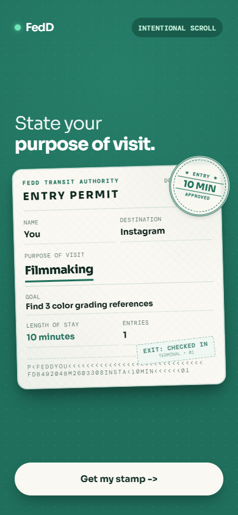
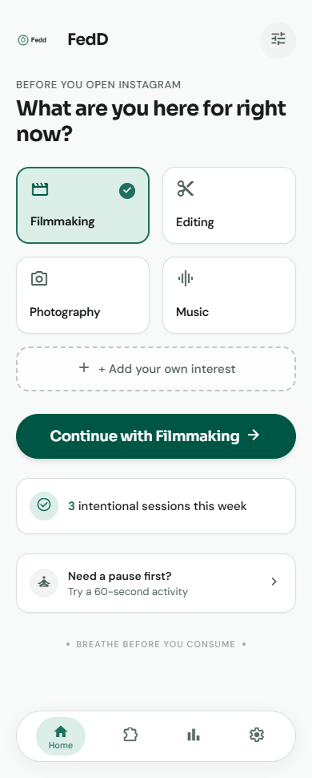
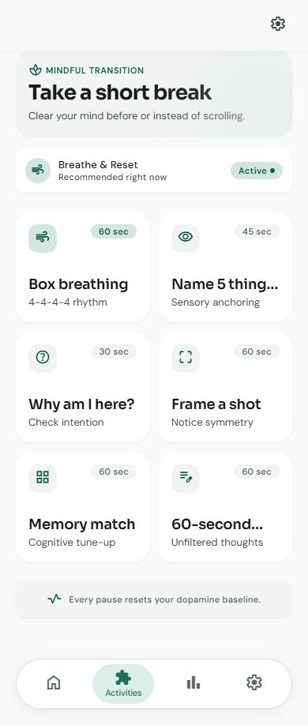
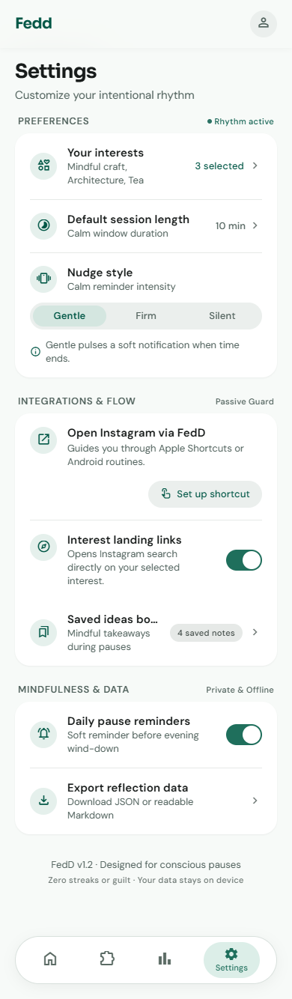

# Fedd

**A calmer way to start—and finish—an Instagram session.**

Fedd is an Android app for intentional scrolling. Choose an interest, set a goal and a time window, take a short pause, then open Instagram. When time is up, a gentle notification invites you to check in and save something useful.

Fedd never blocks Instagram or claims to filter its feed. Interest links help you navigate; Instagram controls the content you see. Your profile and reflections work offline, while Instagram requires its own connection.

## Main features

- **First-use landing:** the uploaded Entry Permit design appears once before profile creation; saved profiles return to their usual unlock or Home flow.
- **Original logo:** the supplied JPEG is copied byte-for-byte into Android launcher resources and fitted proportionally.
- **Intentional sessions:** select up to three saved interests, choose a duration and optional goal, and pause before opening Instagram.
- **Calm nudges:** Gentle, Firm and Silent notification styles. Firm includes one follow-up after two minutes unless Check-in has opened. A five-second test lets you try the selected style.
- **Check-in and saved ideas:** record whether you found what you needed, take five more minutes, or reset after distraction.
- **Short activities:** box breathing, name five things you see, intention reflection and free writing. Frame a shot and Memory match are currently explicit placeholders.
- **Insights without streaks:** wins and summaries calculated from your stored session history.
- **Offline profile:** a name-based profile with optional PIN or supported Android biometric/device-lock authentication.
- **Private local storage:** Android Keystore-backed encrypted storage for interests, goals, history, ideas, activities and preferences; existing data is migrated.
- **Encrypted backups:** choose a local folder, back up with your own password, and restore after reinstalling. Keep the backup and password; there is no server-side password reset.

## Screenshots and design references

These are **Google Stitch design screenshots**, including the newly supplied Entry Permit landing page; they are not captures of the current APK. Some text and controls differ from the implemented app. The source preserves the existing design; these references do not promise feed filtering, Apple Shortcuts support or medical outcomes.



| Home | Activities | Settings |
| --- | --- | --- |
|  |  |  |

## Install on Android

Requires **Android 7.0 (API 24) or newer**. Download `Fedd-v1.1.apk` from this repository's **Releases → Assets** when the owner publishes a release. A release has not been published as part of this repository preparation.

1. Download the APK on your phone, or transfer it from your computer using USB File Transfer or Quick Share.
2. Open the APK in your phone's Files app.
3. If Android asks, allow that Files/browser app to **install unknown apps**, then select **Install**.
4. Open Fedd and allow notifications to receive nudges. Android's Alarms & reminders permission improves delivery precision.

The signed release contains the application bundle and runs without Metro, a development server or a companion app. Install compatible updates over the existing app to preserve data. Before uninstalling, create an encrypted backup in a persistent folder and retain its password. After reinstalling, restore from the login screen and configure a new optional app lock.

With Android platform-tools and USB debugging enabled:

```powershell
adb devices
adb install -r .\artifacts\github-release\Fedd-v1.1.apk
adb shell am start -n com.fedd/.MainActivity
```

Package: `com.fedd`. The existing APK's launcher label is `FedD`; the project name remains **Fedd**. Fedd v1.1 uses the supplied, unchanged JPEG for the Android launcher icon; the package name and release signing certificate are unchanged.

## Technologies

- React Native **Community CLI**, React 19 and TypeScript
- React Navigation with native-stack and bottom tabs
- Kotlin native Android modules for alarms, notifications, authentication and the Storage Access Framework
- Android Keystore and AES-256-GCM for local data; password-derived encryption for backups
- Gradle, Android SDK/NDK and Hermes
- Jest, ESLint, TypeScript checks and Android JVM crypto tests

There are no Expo, Expo Go, EAS, Firebase or backend login dependencies. AsyncStorage is retained for migration of older local data.

## Development

Use Node.js **22.11+**, JDK **17**, and Android Studio/SDK. This checkout specifies compile SDK **37**, build-tools **37.0.0**, target SDK **36** and NDK **27.1.12297006**. See `android/build.gradle` for authoritative values. Configure `JAVA_HOME`, `ANDROID_HOME` and your local SDK path; `local.properties` stays untracked.

```powershell
npm ci
npm run check
```

Fresh clones need a local debug keystore because signing keys are excluded from source control. Run the following only if `android/app/debug.keystore` does not exist. These are standard public debug credentials, never release credentials:

```powershell
keytool -genkeypair -keystore android/app/debug.keystore -storepass android -keypass android -alias androiddebugkey -keyalg RSA -keysize 2048 -validity 10000 -dname "CN=Android Debug,O=Android,C=US"
```

Start an emulator or connect a USB-debugging phone, then run in separate terminals:

```powershell
npm start
npm run android
```

On the configured Windows build machine, `scripts/android-env.ps1` loads the existing external toolchain. `scripts/setup-android-tools.ps1` documents the optional local provisioning workflow; review it before running on another machine.

## Build a signed standalone APK

On the configured Windows machine:

```powershell
.\scripts\build-apk.ps1
```

The script invokes Gradle `assembleRelease`, verifies signing, alignment, package, JavaScript/assets and native libraries, then writes `artifacts/Fedd.apk`. It reads private signing configuration outside the repository. Keep the original release key and its credentials secure for compatible updates; do not generate a replacement key for an existing installation.

For a separately configured build environment, supply `FEDD_RELEASE_STORE_FILE`, `FEDD_RELEASE_STORE_PASSWORD`, `FEDD_RELEASE_KEY_ALIAS` and `FEDD_RELEASE_KEY_PASSWORD` securely, then run `.\gradlew.bat assembleRelease` from the Android folder. Never commit those values.

## Verification and current limits

The v1.1 signed release reported **BUILD SUCCESSFUL** and passed signature, bundled-assets, exact-logo and emulator installation/launch checks. An in-place update preserved saved interests and session count; a clean install showed Entry Permit once, then the existing profile flow. Verification recorded **143 JavaScript tests**, **9 native crypto tests**, TypeScript and ESLint passing. Emulator checks include PIN-gated notification entry into Check-in, backup/restore and recovery after a clean reinstall.

Physical-phone sound/vibration, fingerprint/device credentials, Instagram-app handoff, battery-saver behavior and older Android versions still require device testing. Android system-process ANRs were investigated; no Fedd ANR was found in the captured evidence. See [testing evidence and checklist](design/TESTING.md) and [implementation progress](design/PROGRESS.md).

## Release notes

See the [Fedd v1.1 release notes](docs/RELEASE_NOTES.md). APK files and private signing material are excluded from source control. No project-wide open-source license has been selected. Bundled fonts retain their own license files under `assets/fonts`.
